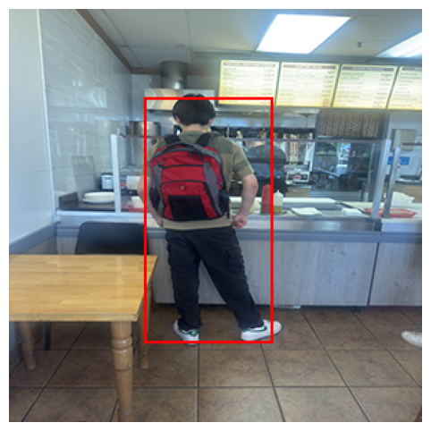

# Single Shot Multibox Detection (SSD) with ResNet-34 Backbone

A PyTorch implementation of **Single Shot Multibox Detection (SSD)** trained on the **Penn-Fudan Pedestrian** dataset.  
This project focuses on building the SSD pipeline end-to-end: dataset + augmentations, anchor generation, IoU matching, box encoding/decoding, hard negative mining, and NMS inference.

Penn-Fudan is small (96 training images) and the pedestrians are often small and skinny, which made RandomIoUCrop behave badly. With parameters like min_scale=0.6 and sampler_options=(0.5, 0.7, 0.9), valid crops were often impossible because many pedestrians occupy only ~10% of the frame. This led to infinite crop search loops, and after loosening constraints, many crops became low quality (background-only, missing GT, or centered people with dropped boxes). To solve this, I replaced IoU-based cropping with a custom GT-centered cropping transform that samples object-centric crops around a randomly chosen GT box, enforces visibility constraints, and includes bounded retries. I also added a safety net in __getitem__ to prevent training samples from ending up with zero GT boxes after augmentation.

- **Dataset**: Penn-Fudan Pedestrian (mask-based boxes via masks_to_boxes)
- **Input size**: 300×300 RGB
- **Classes**: 2 (background + pedestrian)
- **Total anchors**: 7760 per image

## Augmentations

### Photometric + Geometric Pipeline

Training pipeline (torchvision v2):

- ToImage()
- RandomPhotometricDistort()
- RandomChoice()
  - SafeBoxCenteredCrop() (50%)
  - RandomResizedCrop() (30%)
  - Identity() (20%)
- RandomHorizontalFlip(p=0.5)
- Resize((300, 300))
- SanitizeBoundingBoxes(min_size=1)
- ToDtype(torch.float32, scale=True)

### SafeBoxCenteredCrop

A bounded-retry, object-centric crop that:

- picks a target GT box (biased toward larger boxes)
- samples crop size via a **context multiplier** (crop_w/h = s × box_w/h)
- enforces:
  - crop area within a fraction of image area
  - crop aspect ratio bounds
  - target visibility threshold
  - keep threshold for non-target boxes
- falls back cleanly if no crop is valid

If augmentation drops all boxes, __getitem__ falls back to:
1) pipeline without crop  
2) if still empty, preserve the largest original box

## Backbone

This SSD uses a ResNet-34 ImageNet-pretrained backbone, modified to output multi-scale feature maps for SSD heads.

### Original ResNet-34

| Stage    | Operation                        | Output Shape (C × H × W) |
| -------- | -------------------------------- | ------------------------ |
| Input    | -                                | 3 × 300 × 300            |
| Conv1    | 7×7, stride 2, pad 3             | 64 × 150 × 150           |
| MaxPool  | 3×3, stride 2, pad 1             | 64 × 75 × 75             |
| Layer 1  | 3 blocks, stride 1               | 64 × 75 × 75             |
| Layer 2  | 4 blocks, stride 2 (first block) | 128 × 38 × 38            |
| Layer 3  | 6 blocks, stride 2 (first block) | 256 × 19 × 19            |
| Layer 4  | 3 blocks, stride 2 (first block) | 512 × 10 × 10            |
| AvgPool  | global (kernel = 10×10)          | 512 × 1 × 1              |
| FC       | 1000 (ImageNet)                  | -                        |

### Adjusted SSD Backbone Outputs

Anchors are applied starting at Layer2 and onward.

| Stage    | Operation                        | Output Shape (C × H × W) | Anchors |
| -------- | -------------------------------- | ------------------------ | ------- |
| Input    | -                                | 3 × 300 × 300            | No      |
| Conv1    | 7×7, stride 2, pad 3             | 64 × 150 × 150           | No      |
| MaxPool  | 3×3, stride 2, pad 1             | 64 × 75 × 75             | No      |
| Layer 1  | 3 blocks, stride 1               | 64 × 75 × 75             | No      |
| Layer 2  | 4 blocks, stride 2 (first block) | 128 × 38 × 38            | Yes     |
| Layer 3  | 6 blocks, stride 2 (first block) | 256 × 19 × 19            | Yes     |
| Layer 4  | 3 blocks, stride 2 (first block) | 512 × 10 × 10            | Yes     |
| C5       | Conv2d(512, 256, ks=3, s=2, p=1) | 256 × 5 × 5              | Yes     |
| C6       | Conv2d(256, 256, ks=3, s=2, p=1) | 256 × 3 × 3              | Yes     |
| C7       | Conv2d(256, 256, ks=3, s=2, p=1) | 256 × 1 × 1              | Yes     |

All maps are projected to 256 channels before prediction heads.

## Feature Maps

Feature maps produced by the backbone:

- f3: (1, 256, 38, 38)  
- f4: (1, 256, 19, 19)  
- f5: (1, 256, 10, 10)  
- f6: (1, 256, 5, 5)  
- f7: (1, 256, 3, 3)  
- f8: (1, 256, 1, 1)  

## SSD Heads

Each feature map predicts:

- **box offsets**: 4 values per anchor
- **class logits**: 2 values per anchor (bg vs pedestrian)

For each map:

- box_head: Conv2d(256, 4 * N_ANCHORS, kernel=1)
- cls_head: Conv2d(256, N_ANCHORS * N_CLASSES, kernel=1)

Where:

- N_ANCHORS = 4
- N_CLASSES = 2

## Anchors

Anchors are generated per feature map using:

- centers aligned to grid locations ((i+0.5)/W, (j+0.5)/H)
- a custom scale list and ratio list per map
- ratios biased toward tall/skinny boxes for pedestrians

Total anchors:

- 4 × 38 × 38  
- 4 × 19 × 19  
- 4 × 10 × 10  
- 4 × 5 × 5  
- 4 × 3 × 3  
- 4 × 1 × 1  
= **7760 anchors per image**

Given 96 training examples:

- 96 × 7760 = 589,440 anchor predictions per epoch

Anchors are stored in both:
- corner form (x1, y1, x2, y2)
- center form (cx, cy, w, h)

## Matching

During training, GT boxes are matched to anchors using IoU:

- compute IoU between all anchors and GT boxes
- positives:
  - anchors with IoU >= 0.5
  - plus the best anchor for each GT (forced positive)

This yields a boolean mask pos used for both box regression and classification.

## Box Encoding and Decoding

SSD regression uses normalized offsets relative to anchor boxes.

### Encoding

Given anchor A and GT G in center form:

- t_x = (Gx - Ax) / Aw / sigma_xy
- t_y = (Gy - Ay) / Ah / sigma_xy
- t_w = log(Gw / Aw) / sigma_wh
- t_h = log(Gh / Ah) / sigma_wh

Default:
- sigma_xy = 0.1
- sigma_wh = 0.2

### Decoding

- Px = t_x * sigma_xy * Aw + Ax
- Py = t_y * sigma_xy * Ah + Ay
- Pw = exp(t_w * sigma_wh) * Aw
- Ph = exp(t_h * sigma_wh) * Ah

## Loss

Total loss is:

- **Smooth L1** for box regression (positives only)
- **Cross entropy** for classification (positives + mined negatives)

### Hard Negative Mining

For each image:

- compute classification loss per anchor
- keep:
  - all positives
  - top-k negatives by loss, where:

k = min(negative_ratio * num_pos, num_neg_available)

Default:
- negative_ratio = 4

## Training

- **Optimizer:** Adam(lr=1e-3)
- **Epochs:** 100
- **Loss functions:**
  - SmoothL1Loss(beta=0.1, reduction='sum') for boxes
  - CrossEntropyLoss(reduction='none') for mining negatives
- **Checkpointing:** best loss checkpoint saved to ssd_resnet34_pennfudan_best.pt (Too large to push to Github)
- **Validation:** none (dataset too small)

## Inference

Inference steps:

1) forward pass --> t_pred, cls_logits, anchors
2) take foreground probability: softmax(cls_logits)[..., 1]
3) threshold by confidence (default 0.5)
4) decode offsets relative to selected anchors
5) scale normalized coords back to image space
6) apply NMS (default IoU threshold 0.45)
7) keep top-k (default 20)

Predictions on training images:

Prediction on a random image in my camera roll:

Built by Kaizen Rowe